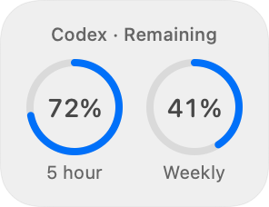
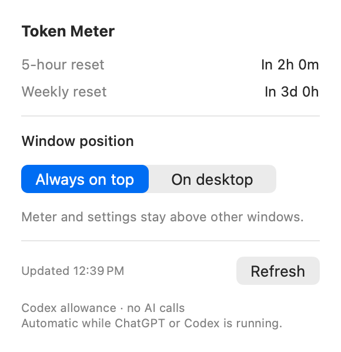

# Token Meter

**Codex allowance at a glance, on your Mac.**

Token Meter puts two small rings on your desktop: one for the five-hour Codex usage window and one for the weekly window. See what remains, check reset countdowns, and return to your work without opening a separate usage page.

These are **remaining quota percentages**, not a literal token balance, a bill, a per-chat measurement, or a meter for every ChatGPT model.

> **Release status:** Local review candidate 1.0.7. No public download or repository has been published. MIT licensing is approved and applied. Signing and release approval are pending.

## A small native companion




Actual application views rendered in `--demo` mode with synthetic values. They contain no account readings. Colors and materials follow macOS appearance.

- **Two allowance rings.** Amber at 20% remaining, red at zero.
- **Reset countdowns.** Click the rings to open settings, or use the menu-bar gauge.
- **Your preferred placement.** Keep both windows above other apps, or let them sit behind your work. Selecting **On desktop** collapses settings; another click reopens them.
- **Drag to position.** Move the meter anywhere; its position is remembered. Reset it from the menu bar if needed.
- **Automatic monitoring.** Reads when a supported ChatGPT or Codex desktop app is running, with a three-minute polling interval and manual refresh.
- **Honest failure states.** Missing values show a dash; a failed read marks retained readings as offline/last-known.

## Platforms and requirements

Token Meter is a native **macOS application** built with Swift, SwiftUI, and AppKit. The build targets macOS 13 or later. The local candidate was tested on an Apple-silicon Mac running macOS 27.0.1; older macOS versions and Intel hardware still need runtime validation. No Windows, Linux, iOS, or browser version is supplied.

Live readings require a compatible, separately installed Codex executable and an existing Codex sign-in that provides the supported allowance windows. The application looks in supported ChatGPT/Codex app bundles under `/Applications` and `~/Applications`, then standard Homebrew executable locations. A browser-only ChatGPT session does not activate the meter. The presence of a CLI alone does not activate monitoring: a supported desktop host must be running.

## Download and install

There is **no public download yet**. Do not use guessed release URLs. The [distribution guide](docs/DISTRIBUTION.md) explains the local review ZIP and the remaining Developer ID signing/notarization work.

Once an approved release is available, the intended installation is to unzip **Token Meter.app**, move it into Applications, and open it. Ordinary users will not need Swift, Python, Xcode, or programming tools to run that app. They will still need the compatible Codex installation and sign-in described above.

The current local build is ad-hoc signed, not notarized. It is not a ready-to-distribute Gatekeeper-approved download.

## Configure and use

1. Open Token Meter while your ChatGPT or Codex desktop app is running.
2. Click the rings for reset times, **Refresh**, and **Window position**.
3. Drag the ring box to move it. Use the menu-bar gauge → **Reset Screen Position** to return it to the corner.
4. Quit both supported desktop apps to hide the meter and stop polling. An idle listener remains to detect their next launch. Closing a window is different from quitting an app.
5. Use the menu-bar gauge → **Quit Token Meter** to stop the listener too.

There is no `.env` file, API key field, or separate account setup in Token Meter. Window placement and coordinates use macOS preferences. Login startup is optional; see the distribution guide. Updates are manual, with no self-updater.

## Privacy and connection

Token Meter starts a short-lived local `codex app-server` process and sends only initialization messages and `account/rateLimits/read`. It does not start model turns, purchase credits, redeem resets, or change models. It retains allowance readings in memory and does not write account readings or raw service errors to its own logs.

The separately installed Codex process uses its own authentication, configuration, network connections, and potentially its own logs. Token Meter is **not an offline data source** and is not sandboxed. See [architecture and privacy](docs/ARCHITECTURE.md) and the [security review](docs/SECURITY-REVIEW.md) for the trust boundary.

## Build from source

Developer prerequisites: macOS, Apple's Xcode Command Line Tools (or Xcode) with Swift, and Python 3 for standard-library build/test helpers. There are no package downloads or `pip`, npm, CocoaPods, or Swift Package Manager dependencies.

From this repository's directory:

```sh
./build.sh
./scripts/test.sh
```

The app is created at `build/Token Meter.app`. Test the real windows in a logged-in graphical macOS session:

```sh
./scripts/test.sh --ui
```

Try the actual UI with synthetic data and isolated settings:

```sh
'build/Token Meter.app/Contents/MacOS/TokenMeter' --demo
```

This mode never calls Codex. To make a local review ZIP:

```sh
./scripts/package.sh
```

See [testing](docs/TESTING.md) for mock coverage and limits, and [distribution](docs/DISTRIBUTION.md) for installation and release procedures.

## Known limitations

- Only the `codex` bucket and reported 300-minute / 10,080-minute windows are supported. New or differently sized windows require an update.
- Polling does not guarantee that upstream values are newly calculated. The displayed “Updated” time is the successful read time, not a provider calculation timestamp.
- Codex executable locations, sign-in behavior, and the app-server protocol may change. Live service compatibility of this candidate has not been tested against a production account.
- There is no usage history, cost estimate, per-model breakdown, notification system, or browser connection.
- Full VoiceOver, multi-display, sleep/wake, and oldest-supported-macOS acceptance remain release checks.
- Existing private builds used a different preference identifier. This candidate uses provisional `local.tokenmeter.app` and does not migrate those settings or replace the installed app.

## Bugs, ideas, and contributions

Once the reviewed GitHub repository exists, use its Issues tab for reproducible bugs and feature proposals. Include the app/macOS versions, steps, expected result, and actual result. Never attach credentials, Codex configuration, session logs, or unredacted account data. Templates are prepared in `.github/ISSUE_TEMPLATE`.

Use [SECURITY.md](SECURITY.md) for vulnerabilities, not public issues. The private reporting channel must be activated before publication.

[CONTRIBUTING.md](CONTRIBUTING.md) describes the proposed development workflow. Token Meter uses the MIT license; the public repository and contribution workflow are being prepared. All merges and releases require owner authorization.

## Licensing and authorship

Token Meter is licensed under the [MIT License](LICENSE). Copyright (c) 2026 LeadFoot. The owner approved MIT for this project; no public release date has been assigned. The [licensing record](docs/LICENSING-REVIEW.md) documents the decision and comparison.

Token Meter is an independent project. It is not an official OpenAI application. The original twin-ring icon is generated by the included `Source/Icon.swift`; no third-party artwork or Codex binary is bundled.

## Further reading

[Architecture](docs/ARCHITECTURE.md) · [Security review](docs/SECURITY-REVIEW.md) · [Testing](docs/TESTING.md) · [Release guide](docs/DISTRIBUTION.md) · [Roadmap](docs/ROADMAP.md) · [GitHub onboarding](docs/GITHUB-ONBOARDING.md) · [Permissions checklist](docs/GITHUB-PERMISSIONS.md) · [Exhibition plan](docs/EXHIBITION.md) · [Changelog](CHANGELOG.md)
